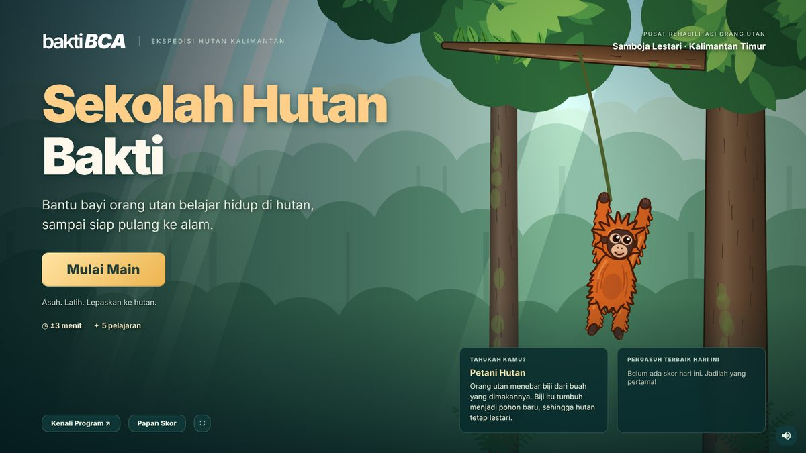

# Sekolah Hutan Bakti · V1

Game edukasi Bakti BCA tentang rehabilitasi orang utan. Pemain menjadi **pengasuh** Bakti, bayi orang utan yatim, dan membantunya melewati lima pelajaran sampai siap dilepasliarkan ke hutan. Formatnya mengikuti *Jejak Si Macan Tutul*: booth pameran, layar sentuh/mouse landscape, satu file HTML offline, papan skor lokal, dan panel panitia.

Pesan utamanya: di alam, anak orang utan belajar dari induknya selama bertahun-tahun. Kalau induknya hilang, manusia harus menggantikan "sekolah" itu, dan butuh waktu lama. Karena itu, menjaga hutan jauh lebih mudah daripada menyelamatkan orang utan.



## Menjalankan di booth

1. Salin **`dist/sekolah-hutan-bakti.html`** ke PC booth.
2. Buka dengan Chrome atau Edge. Semua gambar, kode, dan materi sudah ada di dalam file; internet tidak diperlukan.
3. Pilih tombol layar penuh atau tekan F11. Gunakan monitor/touchscreen landscape (16:9).
4. Coba satu sesi di perangkat booth sebelum acara. Nonaktifkan sleep dan screen saver.

Satu sesi sekitar **3 menit** (bawaan 25 detik per pelajaran, ditambah kartu cara main, rapor, dan penutup).

## Alur

```
Beranda → Misi pengasuh → [Cara main → Pelajaran → Rapor] × 5 → Hari pelepasliaran → Rapor kelulusan + nama → Papan skor
```

| # | Pelajaran | Tahap nyata | Cara main | Pesan |
| --- | --- | --- | --- | --- |
| 1 | **Makanan Bakti** | Nursery | Makanan lewat di batang kayu. Ketuk makanan hutan, lengkapi empat menu sehat (buah, daun & bunga, kulit & umbut, rayap & madu). Makanan manusia (biskuit, permen, soda, mi instan, keripik) = salah. | Orang utan bukan hewan peliharaan; makanannya beragam. |
| 2 | **Pilih Dahan Kuat** | Sekolah hutan | Naik delapan tingkat. Ketuk dahan kuat (cokelat, berlumut, berdaun). Dahan lapuk (pucat, retak, berjamur) patah. Petunjuk makin halus di tingkat atas. | Orang utan menguji dahan sebelum berpindah. |
| 3 | **Jelajah Kanopi** | Sekolah hutan | Cari empat makanan tersembunyi di dedaunan. Lubang rayap dan air di batang membuka pilihan alat (ranting / daun / batu). Saat hujan, cari daun lebar sebagai payung. | Orang utan pandai memakai alat. |
| 4 | **Sarang Sebelum Gelap** | Sekolah hutan | Pilih tempat tidur (semak rendah ✗, pohon mati ✗, percabangan pohon hidup ✓), anyam enam dahan yang bersinar, lalu alasi lima helai daun. Langit makin gelap mengikuti waktu. | Sarang baru setiap sore, tinggi dan kuat. |
| 5 | **Amati, Jangan Bantu** | Pulau pra-pelepasliaran | Bakti bergerak sendiri. Ketuk Bakti saat ia memanjat, makan, memakai alat, membuat sarang, atau menjauhi perahu petugas. Dua kali muncul godaan *Beri pisang* dan *Elus Bakti*: jangan ditekan. | Bakti harus mandiri dan tetap liar. |
| — | **Hari pelepasliaran** | Pelepasliaran | Animasi kandang angkut terbuka, Bakti memanjat, menebar biji, bibit tumbuh. Bisa dilewati. | Orang utan adalah petani hutan. |

Bakti tumbuh sedikit lebih besar di setiap pelajaran. Semua lima pelajaran selalu dilalui; bintang rapor menunjukkan seberapa baik Bakti siap.

## Skor

| Aksi | Poin |
| --- | --- |
| Aksi benar (makanan hutan, dahan kuat, temuan, alat tepat, payung, tempat sarang, catatan perilaku) | +10 |
| Menganyam dahan / menambah daun alas | +5 |
| Menahan godaan | +15 |
| Makanan untuk menu yang sudah penuh | +2 |
| Aksi salah (makanan manusia, dahan lapuk, alat salah, tempat sarang salah) | −5 |
| Mencatat saat Bakti sedang diam | −3 |
| Salah urutan menganyam | −2 |
| Menekan godaan | −10 |
| Bonus waktu saat pelajaran selesai sebelum waktu habis | +2 per detik tersisa |

Skor tidak pernah di bawah nol; potongan aktual yang dicatat. **Bintang per pelajaran:** selesai dengan ≤1 kesalahan = ★★★, selesai = ★★, belum selesai tapi ≥ separuh = ★, selain itu kosong. Maksimal 15 bintang. Papan skor diurutkan berdasarkan skor, lalu jumlah kesalahan, lalu waktu tercepat menyimpan.

Ketuk asal-asalan (lima ketukan kosong dalam 1,6 detik) menghentikan input sejenak dengan pesan "Pelan-pelan, amati baik-baik!".

## Panel panitia dan data

Ketuk pojok kiri atas beranda lima kali, atau tekan **Ctrl+Shift+A**. PIN awal: **1234**; ganti `adminPin` di `js/config.js` lalu bangun ulang. PIN ini pengunci antarmuka lokal, bukan autentikasi server.

Panel berisi: waktu per pelajaran **20 / 25 / 30 / 40 detik**, suara, ekspor CSV, simpan/muat cadangan JSON, dan hapus skor. Tombol **Menu utama** (atau Esc) di layar main menghentikan sesi tanpa menyimpan skor.

Skor hanya tersimpan di browser/perangkat tersebut. Untuk pindah PC, lihat `dist/PANDUAN-PINDAH-PC.txt`. CSV memuat skor, bintang, salah langkah, bonus waktu, dan poin tiap pelajaran.

## Angka program

Teks di `js/content.js` **tidak boleh mengandung digit** (diperiksa `tools/check-no-digits.mjs`). Angka yang tampil diambil dari `js/config.js`:

```js
releasedCount: 49,   // dari halaman Pelestarian Orangutan di situs BCA
releasedSince: 2012,
```

Dashboard internal program memuat angka yang berbeda. Tim komunikasi perlu memilih angka resmi; ganti nilainya atau isi `null` untuk memakai kalimat tanpa angka.

## Mengembangkan

Tanpa dependency runtime atau framework. Versi multi-file:

```sh
python -m http.server 8080
```

Buka `http://localhost:8080`. Untuk distribusi satu file:

```sh
node tools/build-single.mjs
```

Uji regresi (Playwright + Chromium) memainkan kelima pelajaran lewat klik sungguhan, termasuk kesalahan yang disengaja, papan skor, ekspor CSV, dan keluar di tengah sesi:

```sh
node tools/test-game.mjs                               # versi multi-file
node tools/test-game.mjs dist/sekolah-hutan-bakti.html # versi satu file
```

`SHB_TEST_OUTPUT` mengganti folder tangkapan layar. `tools/gallery.html` menampilkan semua pose Bakti, makanan, dahan, dan latar untuk dicek ilustrator.

Struktur:

- `js/config.js` — waktu, poin, angka program, PIN.
- `js/content.js` — semua teks: pelajaran, makanan, alat, perilaku, fakta, panel program.
- `js/art/orangutan.js` — Bakti: rangka sendi, 19 pose, ekspresi, benda di tangan.
- `js/art/props.js` — makanan, alat, dahan sehat/lapuk, sarang, kandang, perahu, bibit.
- `js/art/scenery.js` — latar nursery, kanopi, pulau, hutan pelepasliaran.
- `js/lessons/*.js` — satu file per pelajaran + `release.js` untuk penutup.
- `js/game.js` — alur sesi, skor, bintang, rapor. `js/main.js` — layar, input, admin.

## Sumber

- [Pelestarian Orangutan – BCA](https://www.bca.co.id/id/tentang-bca/CSR/Bakti-BCA/bakti-lingkungan/pelestarian-orangutan): kemitraan dengan BOSF dan BKSDA Kalimantan Timur sejak 2012, pelepasliaran 49 orang utan, program edukasi.
- [Perbaikan 4 pulau buatan BOSF – Investortrust](https://investortrust.id/financial/8543/dukung-pelestarian-orang-utan-bca-perbaiki-4-pulau-buatan-konservasi-bosf): dua pulau pra-pelepasliaran dan dua pulau suaka di Samboja.
- [Student Goes to Nature 2025 – IDX Channel](https://www.idxchannel.com/news/bakti-bca-gelar-student-goes-to-nature-2025-ajak-pelajar-kenali-orang-utan/all)
- [Sekolah hutan sebelum pelepasliaran – Mongabay](https://mongabay.co.id/2023/12/16/sebelum-dilepasliarkan-orangutan-harus-lulus-sekolah-hutan/)
- Fakta umum biologi orang utan (makanan, sarang harian, pemakaian alat, tidak berenang, tidak berekor) ditulis tanpa angka.

Bakti adalah tokoh rekaan dan tahapan rehabilitasi disederhanakan untuk permainan. Semua ilustrasi digambar dengan kode. Tulisan "bakti BCA" adalah teks identitas, bukan aset logo resmi; gunakan master logo dari tim brand untuk produksi final.
